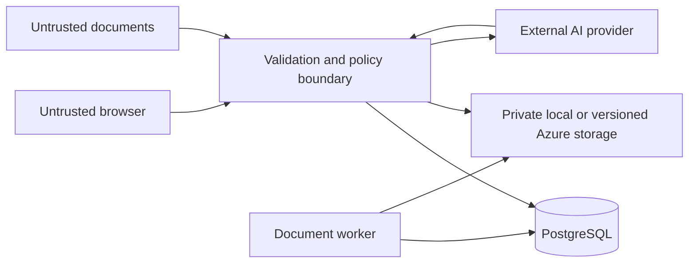

# Security model

This is an engineering threat model for the competition artifact and the
completed local Milestone 1–6 system, not a certification or guarantee.
Individual users authenticate and may hold exact memberships in multiple
isolated workspaces. Closed roles and permissions, typed sharing, ownership,
comments, workflow/agent visibility and invocation, approval eligibility, and
revocation are authorized server-side.

## Assets

- User-authored notes and canvas topology
- Uploaded source files and extracted content
- Document embeddings and retrieval metadata
- AI instructions, responses, citations, and execution snapshots
- Trace and canonical domain records
- User credentials, sessions, password-reset tokens, and account export requests
- OpenAI API credentials and provider metadata
- Database, job queue, worker, and private object-storage integrity

## Trust boundaries



The browser, cookies and CSRF input, uploaded content, filenames, client MIME types, model output,
and provider citation identifiers are untrusted. The API is responsible for authentication,
authorization, workspace scoping, validation, retrieval limits, prompt boundaries, and safe
persistence.

## Implemented controls

### Secrets and provider calls

- OpenAI keys are read only by the API process.
- The frontend has no OpenAI SDK or credential path.
- Only `NEXT_PUBLIC_*` configuration is browser-visible; secrets must never use that prefix.
- Provider selection is explicit; missing live credentials fail configuration or the operation and
  never select deterministic behavior silently.
- Demo mode rejects OpenAI credentials and live providers.

### Uploads and files

- Extension, declared media type, detected signature/structure, and byte size are checked server-side.
- Filenames are sanitized and are not used as storage paths.
- Opaque generated storage keys live outside executable and publicly served roots.
- PDF page count/extracted text and DOCX archive member/expanded size are bounded.
- DOCX traversal-like members and encrypted archives are rejected.
- TXT and Markdown must be UTF-8 and must not contain binary nulls.
- Internal storage paths are not returned by the API.

There is no antivirus or content-disarm scanner; supported parsing libraries still form an attack surface.

### Prompt injection and grounding

- Uploaded text is delimited and labeled as untrusted source data.
- System instructions tell the provider not to follow instructions embedded in source content.
- Retrieval is scoped to ready documents explicitly selected on the current canvas.
- Source IDs are created by the server, not supplied by uploaded content.
- Provider citations are validated against retrieved chunks.
- Unknown citations, citation-free grounded claims, and cited insufficient-evidence outputs are rejected.

Prompt injection defenses reduce risk but do not prove that model output is correct or safe. Users must review generated output.

### Persistence and isolation

- SQLAlchemy parameterizes normal application queries.
- Revision checks reject stale updates.
- Canonical repositories require workspace scope; same-workspace relationship constraints provide database defense in depth.
- Database-backed sessions expire and can be revoked; state-changing browser requests require a
  matching CSRF token.
- Every workspace/canvas, document/file, execution, citation, Trace, and rerun lookup derives or
  verifies ownership server-side and returns a not-found boundary for foreign identifiers.
- Document deletion removes live dependent source records and opaque file bytes; immutable execution evidence is retained deliberately.
- Demo mode restricts database and file paths to `.runtime/demo` and refuses production environment mode.

### Network and application surface

- CORS uses configured explicit origins with credential support; wildcard origins are rejected.
- API strings, lists, context size, file size, and retrieval parameters are bounded.
- Authentication, per-user, per-workspace, and expensive-operation limits are enforced; counters
  remain process-local.
- API errors expose safe codes/messages rather than internal storage paths.
- Production mode disables interactive API docs.
- Reference containers run application processes as non-root users.

## Data sent to OpenAI

In live mode, the API may send the user instruction, selected note content, retrieved document passages, stable source labels, and grounding instructions to OpenAI. Entire documents are not sent by default. Embedding requests send chunk text. Provider data handling is governed by the user’s OpenAI account and applicable policies.

In mock/demo mode, no OpenAI request is made. Judges should use mock/demo mode for non-sensitive deterministic evaluation.

## Controlled-agent planning boundary

Milestone 4.0 adds no active agent behavior. Future controlled agents are an additional untrusted
decision source behind the API policy boundary; model output can propose but cannot authorize an
action. Every future provider or tool attempt must pass a server-side policy enforcement point with
an authenticated user, one owned workspace, an immutable context/plan hash, a narrow expiring
capability grant, current resource-version checks, and explicit approval for durable effects.

External, destructive, privilege-changing, cross-workspace, arbitrary-network, shell, code,
filesystem, raw-database, and credential operations remain prohibited throughout Milestone 4.
Recursive delegation, self-scheduling, ambient execution, and agent-created permissions are also
prohibited. The detailed threat model and phase gates are in
`MILESTONE_4_CONTROLLED_AGENT_ARCHITECTURE.md`.

Milestone 4.1 now defines a side-effect-free, deny-by-default policy contract. Authority must bind
the authenticated user, workspace, execution, closed capability, exact versioned resource, policy
version, immutable plan digest, immutable context digest, and validity window. Revocation records
are append-only. Required approvals additionally bind the grant and exact capability/resource set;
expired, revoked, altered, mismatched, or already-consumed approvals are denied. The evaluator does
not consume approvals itself: a future persistence boundary must record policy decision and
single-use approval consumption atomically before an effect is introduced.

These contracts are deliberately disconnected from routes, providers, tools, workers, schedulers,
and database mutation. They confer no authority merely by existing in client or process memory.
Server authentication, ownership checks, resource-version checks, and persistence constraints
remain mandatory when the contracts are integrated in a later reviewed checkpoint.

Milestone 4.1B implements that persistence boundary without activating agents. Security records are
append-only through ORM mutation rejection and database UPDATE/DELETE triggers. Composite foreign
keys preserve execution/user/workspace scope, and ownership-scoped repository queries join the
current workspace owner before returning data. Unknown, foreign, deleted-workspace, or malformed
identifiers share a not-found boundary.

PostgreSQL row validation must depend only on exact application row data and
server-derived application authority, never the database session login.
Migration `0021` and the matching `WorkspaceMembershipTransition` metadata
currently violate that rule because an unquoted `current_role` token resolves
to special expression `CURRENT_ROLE`. The
[migration 0021 current-role compatibility amendment](MILESTONE_7_POSTGRESQL_MIGRATION_0021_CURRENT_ROLE_COMPATIBILITY_AMENDMENT.md)
selects an explicitly quoted table-column expression and requires
session-role-independence plus migration/ORM parity proof before production
acceptance. Migration `0021`'s raw owner-backfill `INSERT` independently uses
bare `current_role` in its target list, causing a PostgreSQL syntax failure
before application row data can be recorded. The
[migration 0021 owner-backfill current-role compatibility amendment](MILESTONE_7_POSTGRESQL_MIGRATION_0021_BACKFILL_CURRENT_ROLE_COMPATIBILITY_AMENDMENT.md)
authorizes quoting only that target identifier and requires proof that the
stored application value remains `owner`, database session identity is never
inserted, server-derived scope remains exact, and failures leave no partial
evidence.

The original PostgreSQL controlled-agent trigger function remains the
deny-all update/delete authority. Complete PostgreSQL proof for the later
collaboration tables is currently blocked by four undefined function-name
references in historical migrations `0023` and `0024`. The
[trigger-function compatibility amendment](MILESTONE_7_POSTGRESQL_TRIGGER_FUNCTION_COMPATIBILITY_AMENDMENT.md)
authorizes only reuse of the existing function; production acceptance still
requires live trigger identity, rejection, rollback, and full migration-cycle
validation.

One-time approval use is enforced by a unique database constraint. The repository reloads the
stored context, plan, grant, approval, revocations, and existing consumption IDs; verifies their
original canonical digests; evaluates the pure policy contract; and writes an allow decision and
consumption in one savepoint. Expired, revoked, replayed, altered, or scope-mismatched authority
does not create a consumption. Denial decisions for an owned execution remain auditable.

The inspection API is GET-only, bounded to 100 history rows per collection, and omits raw contract
payloads, session IDs, issuing-service data, secrets, headers, and credentials. There is still no
agent controller, provider boundary, tool, effect, worker, queue, scheduler, or delegation path.

The new tables use restrictive deletion to preserve security evidence. Before active production
use, privacy erasure, retention duration, legal/security holds, redaction, and cryptographic-erasure
policy must be reconciled with account deletion. No cleanup worker or automatic deletion behavior
is introduced here.

## Logging and Trace

Trace is durable provenance and can contain object associations, structured metadata, safe errors, and operation names. AI execution tables intentionally contain instructions, selected content snapshots, retrieved passages, and output. These records may be sensitive even though they are not ordinary application logs.

Trace and execution APIs enforce workspace ownership and redact secrets, authorization headers,
hidden system instructions, internal paths, and unsafe diagnostics. Formal retention, export
artifact generation, redaction workflows, and audit-administrator policy remain deployment work.

## Secure object ingestion and malware quarantine

Milestone 7.3 makes quarantine the default for every new uploaded object.
One-time upload capabilities bind one server-owned opaque object, immutable
version, exact size, SHA-256, media contract, scope, and expiry. They can write
only quarantine and do not grant read, completion, promotion, or publication
authority.

A scanner result is accepted only through a rate-limited HMAC-authenticated
service path and must bind the exact scan request, immutable provider version,
ETag, byte size, SHA-256, scanner identity/version, malware policy version,
closed verdict, and completion time. Only a current `clean` result permits a
server-side copy to a new clean version; the target is rehashed. Every unsafe,
unknown, stale, cancelled, forged, replayed, mismatched, or cross-scope result
remains quarantined.

Parsing, retrieval, models, downloads, and Indexer publication recheck the
current clean promotion and evidence. They do not trust a filename, extension,
client claim, object location, mutable provider tag, or personal cloud
identity. Operational procedures are in
[`OBJECT_INGESTION_RUNBOOK.md`](OBJECT_INGESTION_RUNBOOK.md).

## Durable work and shared-limit boundary

Milestone 7.4 makes PostgreSQL the durable job truth. Queue delivery never
grants authority. Server-loaded user, membership, workspace, canvas,
document, immutable version, authority generation, cancellation generation,
source version, lease generation, worker identity, deadline, and attempt
limits fence every protected result. A stale, canceled, expired, superseded,
or revoked worker cannot commit result, publication, audit, Trace, or domain
event evidence.

Requests, job runs, deliveries, attempts, retry decisions, outcomes, dead
letters, and replay requests use distinct identities. Material transitions
extend the existing transaction, Trace, audit, domain-event, and outbox
boundaries. Dead-letter replay requires current workspace-settings authority
and creates a new request and job identity.

Protected API paths use one atomic shared decision covering the applicable
network, user, workspace, resource, operation, provider, and global
dimensions. Keys contain only HMAC-derived opaque subjects and a versioned
namespace. Staging and production require private TLS Redis and Microsoft
Entra managed identity; access-key URLs, public fallback, and process-local
fallback are rejected. Store outage or indeterminate output returns a safe
`503`; an authoritative exceeded limit returns `429`.

## Known gaps before internet deployment

- Deployment-specific TLS/reverse-proxy, managed-secret, and key-rotation implementation
- Managed shared-limiter application-to-Azure revalidation, dashboards, and
  centralized abuse operations
- Managed-production scanner integration certification and content
  disarm/reconstruction
- Production multi-service outbox delivery validation and complete durable-job
  lease/dead-letter administration
- Managed encryption/key policy plus executed backup/restore disaster-recovery drills
- Trace retention, privacy requests, redaction, and audit access policy
- Signed supply-chain attestations
- Formal penetration testing and compliance review

## Security testing

The marked backend suite exercises upload validation, path/archive defenses, rate limiting, prompt-injection boundaries, citation validation, and related controls:

```sh
pnpm test:security
```

The canonical release gate is:

```sh
pnpm validate
```

Fresh results belong in the release checklist or CI logs. Historical test counts should not be represented as current unless rerun against the exact release candidate.

## Operational telemetry security

Milestone 7.5 routes operational logs, metrics, and spans through one closed
schema and bounded exporter. User-controlled field names are rejected.
Secrets, credentials, tokens, cookies, raw network addresses, private
identifiers, source/prompt/response content, provider payloads, SQL values, and
hidden reasoning are excluded or redacted at ingestion and export.

Correlations are HMAC-pseudonymized with environment, deployment, kind, and
server-derived scope. They do not grant authority and cannot replace product
Trace, audit, events, outbox, or activity evidence. Public liveness/readiness
does not disclose topology. Operator health composes existing authentication
with a server-owned allowlist and returns only closed safe states.

Staging and production reject disabled, memory, unencrypted, unauthenticated,
unbounded, or placeholder telemetry configuration. Exporter failure cannot
roll back a valid business transaction, while mandatory product evidence
continues to fail its protected transaction if it cannot commit. Sustained
telemetry loss makes production readiness false.

See [OBSERVABILITY_ARCHITECTURE.md](OBSERVABILITY_ARCHITECTURE.md) and
[OBSERVABILITY_OPERATIONS_RUNBOOK.md](OBSERVABILITY_OPERATIONS_RUNBOOK.md).

## Reporting vulnerabilities

Follow `SECURITY.md`. Do not open a public issue containing a secret, exploit payload, private document, or personal information.
